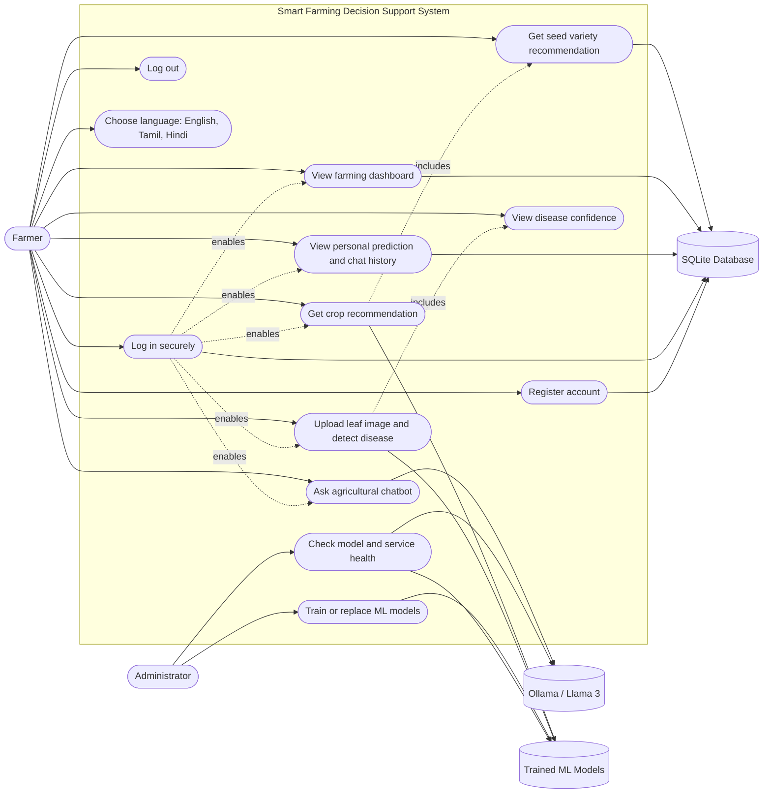
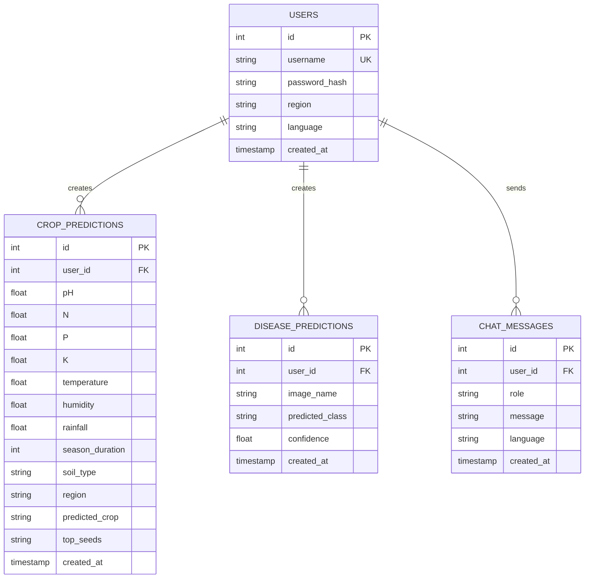

# Smart Farming Decision Support System Diagrams

These diagrams describe the current function-based FastAPI architecture. The service modules are represented as UML classes because they are the application's main architectural units, even though the Python implementation primarily uses modules and functions rather than custom classes.

## UML Class Diagram

```mermaid
classDiagram
    class FastAPIApp {
        +home_get(request, lang)
        +model_health()
        +startup_event()
        +include_router(router)
    }

    class AuthRouter {
        +login_get(request, lang)
        +login_post(request, username, password, lang)
        +register_post(request, username, password, region, lang)
        +logout(request)
    }

    class CropRouter {
        +seed_dashboard_get(request, lang)
        +seed_dashboard_post(request, pH, N, P, K, Temp, Rainfall, Humidity, Soil_Type, Region, lang)
    }

    class DiseaseRouter {
        +disease_dashboard_get(request, lang)
        +disease_dashboard_post(request, file, lang)
    }

    class ChatbotRouter {
        +chatbot_get(request, lang)
        +chatbot_message_post(request, user_message, lang)
    }

    class HistoryRouter {
        +history_get(request, lang)
    }

    class AuthService {
        +register_farmer(username, password, region, language)
        +login_farmer(response, username, password)
        +logout_farmer(response, request)
        +get_current_user(request)
        +sign_value(value)
        +unsign_value(signed_value)
    }

    class CropService {
        +has_crop_models()
        +recommend_seeds(farmer_input)
        -crop_model
        -seed_model
        -encoder
    }

    class SeedService {
        +get_seed_recommendations(predicted_crop, farmer_region, season_duration)
        +parse_duration_match(duration_str, target_days)
        -REGION_STATES
        -CATALOG_PATH
    }

    class DiseaseService {
        +has_disease_model()
        +run_disease_inference(file_path)
        +generate_disease_visualizations(pred_class, confidence)
        -disease_model
        -class_indices
    }

    class ChatbotService {
        +get_chatbot_reply(user_message, lang, conversation_history)
        -ollama_client
        -CHAT_HISTORY_DB
        -SYSTEM_PROMPT_TEMPLATES
    }

    class Database {
        +get_db_connection()
        +init_db()
        +register_user(username, password, region, language)
        +authenticate_user(username, password)
        +add_crop_prediction(...)
        +add_disease_prediction(...)
        +add_chat_message(...)
        +get_crop_predictions(user_id, limit)
        +get_disease_predictions(user_id, limit)
        +get_chat_messages(user_id, limit)
    }

    class SQLiteDatabase {
        <<database>>
        +users
        +crop_predictions
        +disease_predictions
        +chat_messages
    }

    class CropMLModel {
        <<external model>>
        +predict(features)
        +predict_proba(features)
    }

    class DiseaseCNNModel {
        <<external model>>
        +predict(image_tensor)
    }

    class OllamaLlama3 {
        <<external service>>
        +chat(model, messages)
        +list()
    }

    class SeedCatalog {
        <<CSV catalog>>
        +crop varieties
        +recommended zones
        +season durations
    }

    FastAPIApp o-- AuthRouter
    FastAPIApp o-- CropRouter
    FastAPIApp o-- DiseaseRouter
    FastAPIApp o-- ChatbotRouter
    FastAPIApp o-- HistoryRouter

    AuthRouter --> AuthService : uses
    CropRouter --> AuthService : checks session
    CropRouter --> CropService : requests recommendation
    CropRouter --> Database : logs prediction
    DiseaseRouter --> AuthService : checks session
    DiseaseRouter --> DiseaseService : runs inference
    DiseaseRouter --> Database : logs prediction
    ChatbotRouter --> AuthService : checks session
    ChatbotRouter --> ChatbotService : requests reply
    ChatbotRouter --> Database : logs messages
    HistoryRouter --> AuthService : checks session
    HistoryRouter --> Database : reads user history
    FastAPIApp --> Database : reads dashboard summaries

    AuthService --> Database : user authentication
    CropService --> CropMLModel : predicts crop
    CropService --> SeedService : finds seed varieties
    SeedService --> SeedCatalog : reads catalog
    DiseaseService --> DiseaseCNNModel : predicts disease
    ChatbotService --> OllamaLlama3 : sends prompt
    Database --> SQLiteDatabase : direct SQL via sqlite3
```

## Use-Case Diagram

## Main Database Entities

